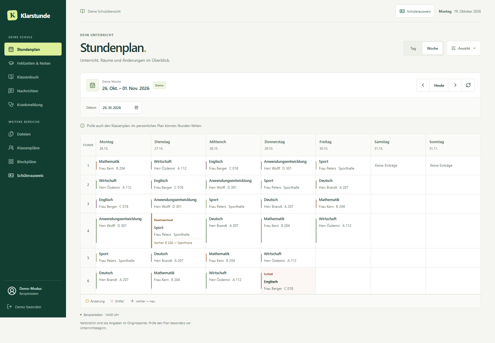

# Klarstunde

Klarstunde ist eine inoffizielle, lokal laufende Schüleransicht für ein eigenes Konto bei `virtueller-stundenplan.org`.

> [!IMPORTANT]
> Dieses Repository ist ein privates Softwareexperiment. Es ist kein offizieller Client, kein Angebot einer Schule und kein Ersatz für das Originalportal. Für verbindliche Angaben zu Unterricht, Vertretungen, Fehlzeiten, Prüfungen und Krankmeldungen gilt ausschließlich der jeweilige Schuldienst.

[Lokal starten](#lokal-starten) · [Vorschau](#vorschau) · [Funktionen](#funktionen) · [Daten und Datenschutz](#daten-und-datenschutz) · [Lizenz und Rechte](#lizenz-und-fremde-rechte)

## Lokal starten

Voraussetzungen für Windows und Linux: **Node.js 24 und pnpm**. Lade das Repository herunter oder klone es und öffne den Projektordner. Vor der Anmeldung mit einem Schulkonto beachte den [gedachten Einsatz](#gedachter-einsatz). Installiere einmal die Abhängigkeiten:

```bash
pnpm install
```

Danach kannst du Klarstunde über die Startdatei öffnen:

| System | Start |
| --- | --- |
| Windows | `start.cmd` doppelt anklicken oder im Projektordner ausführen |
| Linux | Im Projektordner `./start.sh` ausführen; alternativ `sh ./start.sh` |
| Beide Systeme | Alternativ `pnpm launch` |

Der Starter prüft Node.js, die installierten Abhängigkeiten und den lokalen Port. Falls der Build fehlt oder Quelldateien neuer sind, baut er die Oberfläche neu. Anschließend startet er den Server unter `http://127.0.0.1:4173` und öffnet den Standardbrowser. Unter Linux wird dafür `xdg-open` verwendet; ohne grafische Sitzung oder bei fehlendem Browseraufruf bleibt die Adresse zum manuellen Öffnen sichtbar.

**Lass das Startfenster beziehungsweise Terminal geöffnet.** Mit `Strg+C` beendest du Klarstunde. Ein belegter Port wird gemeldet; der Starter beendet keine anderen Programme und öffnet keine unbekannte Anwendung auf diesem Port.

Nur die Voraussetzungen prüfen: `pnpm doctor`. Ohne Browser starten: `pnpm launch --no-open` beziehungsweise `sh ./start.sh --no-open` unter Linux oder `start.cmd --no-open` unter Windows. Fehlen Abhängigkeiten nach einem Update, führe erneut `pnpm install` aus.

Für die Entwicklung:

```bash
pnpm dev
```

Die Oberfläche läuft dann unter `http://127.0.0.1:5173`, der lokale Server unter `http://127.0.0.1:4173`.

Manuell bauen und starten:

```bash
pnpm build
pnpm start
```

Dabei wird die Oberfläche unter `http://127.0.0.1:4173` ausgeliefert. Der Server bindet standardmäßig nur an `127.0.0.1`; der Starter akzeptiert ausschließlich lokale Adressen. „Produktionsbuild“ bezeichnet die Bauart, keine Freigabe für öffentlichen Betrieb.

## Vorschau



Die Vorschau zeigt ausschließlich Beispieldaten. Über „Erst einmal ansehen“ kannst du Stundenplan und Ausweis ohne Schulkonto ausprobieren.

## Abgrenzung

Klarstunde ist ein eigenständiges Projekt. Es besteht keine geschäftliche oder organisatorische Verbindung zum Betreiber von `virtueller-stundenplan.org`, zu einer Schule, einem Schulträger, Ausbildungsbetrieb oder Telegram.

Die genannten Namen und Internetadressen beschreiben nur die technische Anbindung. Sie bedeuten weder eine Zusammenarbeit noch eine Empfehlung oder Freigabe. Rechte an fremden Marken, Logos, Inhalten oder Datenbanken werden durch dieses Projekt nicht eingeräumt.

Fehler in Klarstunde bitte hier im Repository melden, ohne persönliche Daten beizufügen. Verbindliche Fragen zu Schuleinträgen, Unterricht und Meldungen klärst du über die zuständigen Stellen des Originaldienstes.

## Gedachter Einsatz

Das Projekt ist für eine einzelne Person gedacht, die auf dem eigenen Rechner mit dem eigenen, berechtigt genutzten Schulkonto arbeitet. Öffentliches Hosting, ein Dienst für andere Personen, fremde oder gemeinsam genutzte Konten, Massenabrufe und die Umgehung von Zugangskontrollen gehören nicht zum vorgesehenen Betrieb.

Prüfe vor dem Live-Betrieb die geltenden Nutzungsbedingungen und schulischen Vorgaben. Ein gültiges Konto bedeutet nicht automatisch, dass alternative Clients oder automatisierte Abrufe erlaubt sind. Kläre Unklarheiten vorab mit dem Dienstbetreiber beziehungsweise der zuständigen Schule. Diese README ersetzt keine erforderliche Nutzungserlaubnis.

Die Veröffentlichung und Weitergabe des eigenen Quellcodes richtet sich nach der MIT-Lizenz. Der Zugriff auf den fremden Dienst und ein Betrieb für andere Personen sind davon getrennte Fragen. Der beschriebene private Einsatz ist keine zusätzliche Lizenzbeschränkung; siehe [Lizenz und fremde Rechte](#lizenz-und-fremde-rechte).

## Experimenteller Stand

Diese Implementierung verwendet keine vom Betreiber für Klarstunde zugesicherte API. Sie liest die für das angemeldete Konto ausgelieferten HTML-Seiten und bereitet sie neu auf. Schon eine kleine Änderung am Originalportal kann deshalb einzelne Bereiche beschädigen oder Werte falsch zuordnen.

Insbesondere gilt:

- Anzeigen können unvollständig, verspätet oder falsch sein.
- Eine erfolgreiche technische Übermittlung beweist nicht, dass eine Krankmeldung angenommen oder bearbeitet wurde.
- Benachrichtigungen können ausbleiben oder zu spät eintreffen.
- Vor Unterrichtsbeginn und vor wichtigen Terminen sollte der Eintrag im Originalportal geprüft werden.
- Es gibt keine Zusage für Verfügbarkeit, Richtigkeit, Support oder dauerhafte Kompatibilität.

## Funktionen

- persönlicher Tages- und Wochenstundenplan einschließlich Wochenende
- Tages-, Wochen- und Datumswechsel sowie Sprung zur vorherigen oder nächsten Unterrichtswoche über die Navigation des Originalportals
- direkter Vergleich mit dem Wochenplan der eigenen Klasse
- kompakte Darstellung und effektiver Plan wie im Originalportal
- Vertretungen, Raumwechsel, Entfall und parallele Kurse
- Klassenarbeiten, Klausuren und andere Leistungsnachweise
- Fehlzeiten, Anwesenheiten und eingetragene Ergebnisse
- Zeitraum-, Zeugnis-, Fach-, Raum-, Lehrkraft- und Stundenfilter, soweit vom Konto angeboten
- Klassenbuch, Unterrichtsinhalte und Hausaufgaben
- Schul- und Klassennachrichten
- Krankmeldung mit Bestätigung vor dem Absenden und Hinweis bei unklarer Übermittlung
- freigegebene Dateien
- Klassen- und Blockpläne
- digitaler Schülerausweis, sofern freigeschaltet
- direkter Ausweiszugriff und Großansicht für Karte und unveränderten Prüfcode
- optionale Telegram-Hinweise bei bestätigten Stundenplanänderungen
- Demo-Modus ohne Schulkonto

Die Oberfläche orientiert sich am Funktionsumfang des Originalportals. Die vorhandene optionale Telegram-Erweiterung ist daher nicht mehr Bestandteil der Navigation; bestehende lokale Konfigurationen funktionieren weiter.

Stundenzeiten werden ohne belegte Angaben des Quelldienstes nicht ergänzt. Wiederholte Ferienangaben erscheinen einmal je Tag. Fehlen die erwarteten Stundenplantabellen oder passt das gelieferte Datum nicht, erscheint ein Fehler statt eines vermeintlich freien Tages.

Stundenplanantworten können für dieselbe Sitzung bis zu 30 Sekunden wiederverwendet werden. „Neu laden“ umgeht bereits abgeschlossene Cacheeinträge; Abmelden verwirft den zugehörigen Cache. Der Abrufzeitpunkt bezeichnet den persönlichen Plan, der Klassenvergleich kann anschließend separat geladen werden. Die Portalzugriffe derselben Sitzung laufen nacheinander. Einzelheiten zur Speicherung stehen unter [Daten und Datenschutz](#daten-und-datenschutz).

Bei Ladefehlern bleibt ein bereits geladener persönlicher Plan oder Klassenplan sichtbar, mit deutlich gekennzeichnetem früherem Zeitraum und dem Hinweis, dass der Stand nicht aktuell bestätigt ist. „Erneut versuchen“ lädt die gewünschte Auswahl erneut. Ein solcher früherer Stand ersetzt keine aktuelle Prüfung im Originalportal.

**Krankmeldungen:** Eine positive Erfolgsantwort wurde nicht durch einen schreibenden Live-Test verifiziert. Antworten ohne bekannten Fehler werden als „nicht eindeutig bestätigt“ behandelt. Prüfe dann den Stand im Originalportal, bevor du erneut sendest. Die lokale Sperre gegen erneutes Absenden ist kein Nachweis der Annahme und gilt nicht über Sitzungswechsel oder Serverneustarts hinweg. Schulische Meldefristen und Anforderungen bleiben bestehen.

**Schülerausweis:** Die Karte ist eine eigene Darstellung der gelieferten Daten, keine eigenständige Ausstellung oder Beglaubigung. Foto, Angaben und Prüfcode stammen aus dem Originalportal; der angezeigte Status wird nicht unabhängig bestätigt. Ob die Darstellung als Nachweis anerkannt wird, entscheidet die prüfende Stelle. Nutze bei Bedarf das Originalportal oder den von der Schule vorgesehenen Nachweis. Die Demo enthält gekennzeichnete Beispieldaten ohne scannbaren Nachweis.

Nicht jede Schule schaltet dieselben Funktionen frei. Getestet sind nur die Bereiche, die im verwendeten Testkonto sichtbar waren.

Eine genaue Gegenüberstellung mit den öffentlich beschriebenen Funktionen des Quelldienstes steht in [`docs/FUNCTIONS.md`](docs/FUNCTIONS.md). Sie nennt auch die beiden bewussten Grenzen: Office-365-Anmeldung und der nicht verifizierte automatische Versand an einen hinterlegten Ausbildungsbetrieb.

## Anmeldung

Ohne weitere Konfiguration meldet man sich in der Oberfläche an. Klarstunde übergibt E-Mail-Adresse und Passwort an den Originaldienst und hält dessen Sitzungs-ID im Arbeitsspeicher. Der Browser erhält ein eigenes HttpOnly-Cookie.

Beim normalen Neuladen bleibt eine gültige Anmeldung bestehen. Ein Serverneustart beendet die lokalen Sitzungen. Die Standardlaufzeit beträgt acht Stunden und lässt sich über `SESSION_TTL_HOURS` anpassen.

Läuft die Sitzung während der Nutzung ab, kehrt Klarstunde nach erneuter Anmeldung zum zuvor geöffneten Bereich zurück. Datum und Anzeigeoptionen des persönlichen Stundenplans bleiben dabei im Arbeitsspeicher des geöffneten Tabs erhalten; geladene Schuldaten werden beim Wechsel zur Anmeldung aus der Ansicht entfernt. Ein Neuladen oder bewusstes Abmelden setzt den geöffneten Bereich und das ausgewählte Datum zurück. Die nachfolgend beschriebenen Anzeigeoptionen bleiben erhalten.

Für einen persönlichen Einzelplatz kann eine lokale `.env` verwendet werden:

```dotenv
VSP_AUTO_LOGIN_EMAIL=name@schule.de
VSP_AUTO_LOGIN_PASSWORD=dein-passwort
```

Die `.env` ist von Git ausgeschlossen. Trotzdem liegt das Passwort dann unverschlüsselt auf dem Rechner. Die Datei muss nur für das eigene Benutzerkonto lesbar sein. Automatische Anmeldung gehört nicht auf gemeinsam genutzte Geräte, Server, Backups oder öffentliche Entwicklungsumgebungen.

Zugangsdaten gehören nie in Issues, Screenshots, Chatverläufe, Commits oder Build-Artefakte. Ein versehentlich veröffentlichtes Passwort sollte sofort beim Originaldienst geändert werden.

### Ansicht merken

Tag/Woche, kompakte Ansicht, effektiver Plan und Klassenvergleich werden im Local Storage dieses Browsers unter `klarstunde.display.v1` gespeichert. Die Liste ist fest begrenzt: Datum, Konten, Passwörter, Schuldaten und Ausweisabbildungen werden darüber nicht gespeichert. Die Optionen gelten für diesen Browser und diese lokale Adresse, auch im Demo-Modus und nach dem Abmelden.

Unter „Ansicht → Ansicht zurücksetzen“ lässt sich der gespeicherte Eintrag entfernen. Bei gesperrtem Browserspeicher bleibt die Anwendung nutzbar und zeigt einen Hinweis; Einstellungen gelten dann nur im geöffneten Tab.

### Kürzel je Schule

Fach-, Raum- und Lehrkraftkürzel werden von den Schulen unterschiedlich vergeben. Klarstunde enthält deshalb keine fest eingebaute Liste für eine bestimmte Schule. Unbekannte Werte erscheinen unverändert. Eindeutige Bezeichnungen können für die eigene Installation ergänzt werden:

```dotenv
VSP_SUBJECT_LABELS={"E":"Englisch","PO":"Politik"}
VSP_ROOM_LABELS={"A101_PC_24":"A 101 · PC-Raum"}
```

Die Schlüssel müssen exakt den gelieferten Kürzeln entsprechen. Die Beispiele sind keine allgemeingültigen Zuordnungen.

## Telegram-Hinweise

Die automatische Prüfung benötigt das fest hinterlegte Schulkonto und einen eigenen Telegram-Bot:

1. In Telegram `@BotFather` öffnen und mit `/newbot` einen Bot anlegen.
2. Dem neuen Bot eine Nachricht schicken.
3. Über `https://api.telegram.org/bot<TOKEN>/getUpdates` die eigene `message.chat.id` ablesen.
4. Die lokale `.env` ergänzen:

```dotenv
TELEGRAM_BOT_TOKEN=123456:abc
TELEGRAM_CHAT_ID=123456789
TIMETABLE_WATCH_ENABLED=true
TIMETABLE_WATCH_INTERVAL_MINUTES=15
TIMETABLE_WATCH_DAYS=14
```

Eine erkannte Änderung muss bei zwei aufeinanderfolgenden Abrufen gleich sein, bevor Klarstunde eine Nachricht sendet. Das ist eine technische Plausibilitätsprüfung, keine Bestätigung durch die Schule. Wochenenden werden im überwachten Zeitraum übersprungen. Das Mindestintervall beträgt fünf Minuten.

Der Bot-Token ist ein Passwort. Bei aktivierten Hinweisen gehen Datum, Stunde, Fach, Lehrkraft, Raum und gegebenenfalls Prüfungsangaben an Telegram. Aktiviere die Funktion nur, wenn diese Übermittlung für deine Nutzung zulässig und gewollt ist. Die Verarbeitung beim externen Anbieter liegt außerhalb der Kontrolle dieser Anwendung.

Vergleichsstände und Prüfzeitpunkte liegen lokal in `.data/timetable-watch.json`. Die Datei ist von Git ausgeschlossen, enthält aber unverschlüsselte Schuldaten und sollte weder synchronisiert noch weitergegeben werden. Das Ausschalten der Prüfung löscht sie nicht automatisch.

## Kein öffentlicher Betrieb

`PREVIEW_PASSWORD` ist lediglich eine zusätzliche Schranke für einen kurzen, beaufsichtigten Test. Es macht aus Klarstunde keinen für das Internet geeigneten Dienst. Die Anwendung besitzt derzeit unter anderem keine Mehrbenutzertrennung, keine Rechteverwaltung, kein Rate-Limit für Anmeldeversuche und kein Verfahren für einen dauerhaften sicheren Betrieb.

Bei einem vorgeschalteten HTTPS-Zugang muss zusätzlich `COOKIE_SECURE=true` gesetzt werden. Bei einem reinen HTTP-Aufruf bleibt die Option aus, da der Browser das Sitzungscookie sonst nicht zurücksendet.

Insbesondere ein Server mit automatischer Anmeldung darf nicht über eine öffentliche IP, Portfreigabe oder einen dauerhaften Tunnel erreichbar sein. Für einen kurzen Test verwendete Tunnel und Zugangsdaten sollten anschließend beendet beziehungsweise gewechselt werden. Wer vom lokalen Einzelplatzbetrieb abweichen möchte, muss dafür getrennt die nötigen Erlaubnisse, Datenschutzpflichten, Zugangssicherung und gegebenenfalls Anbieterkennzeichnung klären. Diese README ist kein vollständiges Betriebskonzept dafür.

## Daten und Datenschutz

Klarstunde enthält keine Analyse-, Werbe- oder Tracking-Skripte. Für den beschriebenen lokalen Betrieb gilt:

| Daten | Verarbeitung und Speicherung |
| --- | --- |
| Manuelle Anmeldung | E-Mail-Adresse und Passwort werden im lokalen Browser eingegeben und über den lokalen Server an den Originaldienst übermittelt. Klarstunde schreibt das manuell eingegebene Passwort nicht dauerhaft in eine Datei oder Datenbank. |
| Sitzung | Die fremde Sitzungs-ID liegt im Arbeitsspeicher des Servers. Der Browser erhält stattdessen ein eigenes HttpOnly-Cookie. Die lokale Sitzung endet spätestens nach Ablauf oder Serverneustart. |
| Schuldaten und Ausweis | Die Daten werden im Browser angezeigt und im Arbeitsspeicher verarbeitet. Die App legt für diese Inhalte keine Einträge in Local Storage oder IndexedDB an. Ein kurzzeitiger Sitzungscache auf dem Server ist möglich. |
| Anzeigeoptionen | Vier Anzeigeoptionen und eine Formatversion liegen im Local Storage des Browsers. „Ansicht zurücksetzen“ entfernt den Eintrag. Inhalte und Anmeldedaten werden nicht mitgespeichert. |
| Optionale Konfiguration | Eine selbst angelegte `.env` kann Zugangsdaten, Bot-Token und Chat-ID im Klartext enthalten. Auch Umgebungsvariablen sind kein verschlüsselter Passwortspeicher. |
| Optionale Telegram-Prüfung | Vergleichsstände und Prüfzeitpunkte werden in `.data/timetable-watch.json` gespeichert. Sie bleiben auch nach dem Ausschalten der Prüfung erhalten, bis die Datei gelöscht wird. |
| Downloads und eigene Aufnahmen | Browserfunktionen, Downloads, Screenshots und Sicherungen können Daten unabhängig von der Anwendung speichern. |

Manuell eingegebene Passwörter und die fremde Sitzungs-ID werden nicht in API-Antworten an die Oberfläche zurückgegeben. Das verhindert keine Einsicht durch Personen oder Programme mit Zugriff auf deinen Rechner. Die Software sendet im beschriebenen lokalen Betrieb keine Schuldaten an die Projektbetreuer.

Der Ausschluss von `.env` und `.data/` aus Git verhindert keine anderweitige Weitergabe, Backups oder Cloud-Synchronisation. Persönliche Fotos und Prüfcodes, Zugangsdaten, Cookies und Schuldaten gehören nicht in öffentliche Issues, Commits oder Gestaltungsvorschauen. Zeige oder übertrage nur Daten, die für den jeweiligen Zweck erforderlich und zulässig sind.

Fehlzeiten und Krankmeldungen können Gesundheitsinformationen enthalten. Auch Ausweisfotos, Prüfcodes und Lehrkraftangaben können personenbezogene Daten sein. Bei ausschließlich persönlichen oder familiären Tätigkeiten kann die Haushaltsausnahme der DSGVO eingreifen. „Privat“ oder „lokal“ allein beantwortet diese Frage nicht. Bei einer Verarbeitung für andere Personen oder öffentlicher Bereitstellung sind Anwendungsbereich, Verantwortlichkeit und Rechtsgrundlagen gesondert zu prüfen; bei Gesundheitsdaten zusätzlich die besonderen Anforderungen. Maßgeblich sind insbesondere Art. 2 Abs. 2 Buchst. c, Art. 6 und Art. 9 der [DSGVO](https://eur-lex.europa.eu/eli/reg/2016/679/oj/deu). Die Datenschutzhinweise des Originalportals ersetzen keine gegebenenfalls für einen eigenen Betrieb erforderlichen Informationen.

## Schonender Zugriff

Klarstunde darf nur mit einem Konto verwendet werden, für das die nutzende Person zugriffsberechtigt ist. Die automatische Prüfung ist bewusst begrenzt und ruft Tage nacheinander ab. Kürzere Intervalle, parallele Massenabrufe, das Sammeln fremder Klassen- oder Personendaten und der Aufbau eines eigenen Datenbestands sind nicht vorgesehen.

Auch wiederholte Entnahmen kleiner Teile einer Datenbank können rechtlich relevant werden, wenn sie einer normalen Nutzung zuwiderlaufen oder berechtigte Interessen beeinträchtigen. Siehe [§ 87b UrhG](https://www.gesetze-im-internet.de/urhg/__87b.html). Ob die Vorschrift im Einzelfall greift, wird hier nicht bewertet.

## Fehler melden

Bei einem Ladefehler kannst du „Fehlerdetails ansehen und kopieren“ öffnen. Vor dem Kopieren siehst du den vollständigen Bericht: App-Version, betroffener Bereich und eine feste Fehlerkategorie. Fehlermeldung, Datumsauswahl, Konto, Cookies, Seiteninhalte und Adressen werden nicht in diesen Bericht übernommen. Der Bericht wird nur auf deinen Klick kopiert und niemals automatisch versendet. Falls die Zwischenablage nicht zugänglich ist, kannst du den angezeigten Text selbst kopieren.

Ergänze bei einer Fehlermeldung eine kurze Beschreibung der Schritte. Prüfe eigene Texte und Screenshots auf personenbezogene Daten. Eine leere Antwort wird als „keine Einträge geliefert“ angezeigt; eine fehlende Freigabe wird nur bei einem ausdrücklich erkannten Portalhinweis behauptet.

## Projekt prüfen

Alle Prüfungen lokal ausführen:

```bash
pnpm check
```

Oder einzeln:

```bash
pnpm lint
pnpm typecheck
pnpm test
pnpm build
```

Die lokale Browserprüfung benötigt einmalig Chromium:

```bash
pnpm test:ui:install
pnpm test:ui
```

Unter Linux können zusätzliche Browser-Systembibliotheken nötig sein; die Installation beschreibt die [Playwright-Dokumentation](https://playwright.dev/docs/browsers#install-system-dependencies). Die Browserprüfung baut den Client und startet eine eigene lokale Vorschau auf Port `5188`, ohne Backend-Proxy. Sie prüft Desktop, 390 und 320 Pixel Breite. Alle API-Antworten sind nachgebildet; fremde Browser-Anfragen werden blockiert. Es werden weder Schulkonten verwendet noch Krankmeldungen oder Telegram-Nachrichten versendet. Fehleraufnahmen mit diesen Beispieldaten bleiben im ignorierten Verzeichnis `.data/ui-results/`.

`pnpm check` umfasst Lint, Typprüfung, kleine Tests einschließlich Starterprüfung und Build. `pnpm test:ui` wird separat lokal ausgeführt; es gibt keine GitHub Actions.

Live-Zugangsdaten und unveränderte HTML-Seiten mit personenbezogenen Daten gehören nicht in Tests. Parser-Tests verwenden kleine, nachgebildete Ausschnitte.

## Projektstruktur

```text
src/
├── client/             React-Oberfläche
│   └── components/     zusammenhängende Ansichten
├── server/             lokaler Server und Sitzungen
│   ├── notifications/  optionale Telegram-Prüfung
│   └── vsp/            Adapter und HTML-Parser
└── shared/             gemeinsame Datentypen und Bezeichnungen
```

Der fremde HTML-Aufbau bleibt im Verzeichnis `server/vsp`. Änderungen am Originalportal sollen dadurch nicht über die gesamte Anwendung verteilt werden. Architekturdetails stehen in [`docs/CONCEPT.md`](docs/CONCEPT.md), der geprüfte Funktionsstand in [`docs/FUNCTIONS.md`](docs/FUNCTIONS.md).

## Lizenz und fremde Rechte

Der selbst geschriebene Klarstunde-Code steht unter der [MIT-Lizenz](LICENSE). Abhängigkeiten unterliegen ihren jeweiligen Lizenzen.

Die MIT-Lizenz erlaubt unter ihren Bedingungen auch Weitergabe, Veränderung und kommerzielle Nutzung. „Für den privaten Gebrauch gedacht“ beschreibt den vorgesehenen und getesteten Einsatz, ist aber keine zusätzliche Lizenzbedingung.

Die MIT-Lizenz erteilt keine Rechte an

- Namen, Marken oder Logos Dritter,
- Quellcode und Gestaltung des Originalportals,
- Schul- und Personendaten,
- Datenbanken, Texten oder Dateien des Quelldienstes,
- Zugängen oder technischen Schnittstellen Dritter.

Die Lizenz enthält Gewährleistungs- und Haftungsausschlüsse. Diese gelten nur im rechtlich zulässigen Umfang. **Zwingende gesetzliche Ansprüche werden durch die Lizenz oder diese README nicht ausgeschlossen.** Beispielsweise kann die Haftung wegen Vorsatzes nicht im Voraus erlassen werden ([§ 276 Abs. 3 BGB](https://www.gesetze-im-internet.de/bgb/__276.html)); für formularmäßige Haftungsbeschränkungen gelten weitere Grenzen, insbesondere [§ 309 Nr. 7 BGB](https://www.gesetze-im-internet.de/bgb/__309.html).

## Rechtlicher Hinweis

Diese README beschreibt das Projekt und seine Grenzen. Sie ist keine rechtliche Prüfung oder Zusage, dass eine bestimmte Nutzung zulässig ist. Weder die Bezeichnung als privates Experiment noch ein Haftungshinweis verhindert Ansprüche Dritter. Ungeklärte Zugriffsrechte oder ein Betrieb für andere Personen müssen vorab mit den zuständigen Stellen und bei Bedarf mit fachkundiger rechtlicher Beratung geklärt werden.
